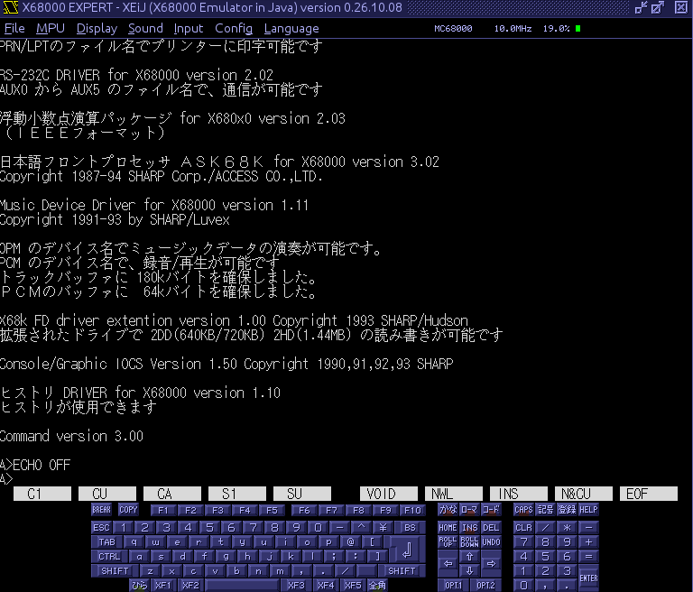

# open-human68k

**Objective**

- Build a free, MIT-licensed replacement for `HUMAN.SYS`, the Human68k v3.02 kernel of the Sharp X680x0 computers.
- Stay compatible enough that the original `COMMAND.X` shell and existing X68000 programs run on it unchanged.
- Keep the code legally clean through a documented clean-room process, so it can be shared and modified freely.
- Document how Human68k behaves internally, so the X68000 community has a readable reference.

open-human68k is a clean-room reimplementation of the Human68k kernel, written in C with a small amount of 68000 assembly. The work is split in two. One side studies the original kernel and writes plain behavioural specifications in `spec/`: the DOS call table, CONFIG.SYS, device drivers, memory and process management, the FAT filesystem and character I/O. A separate side writes the new kernel in `src/` from those specifications and public documentation only, never looking at the original code. The kernel ships on its own boot floppy image and is tested in the XEiJ emulator against the real Human68k, using Sharp's freely released system software as the reference.

